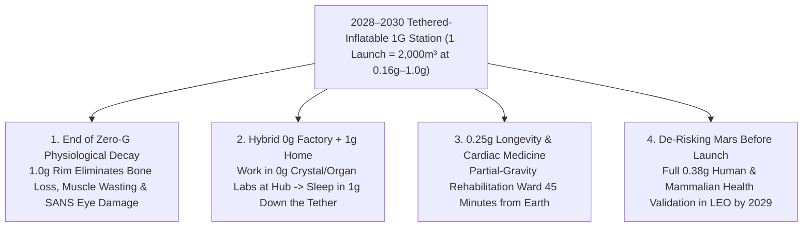

# VISION 02 (LEAPFROG 2026–2030) — SPACE EXPANSION & CISLUNAR CIVILIZATION
## Sub-Pathway 2C: The 2028–2029 Tethered-Inflatable 1G Leapfrog — *Skipping 20 Years of Orbital Steel Construction via Single-Launch Woven Vectran Dumbbells*

> **Executive Framing & The 48-Month Leapfrog Thesis**
> * **The Legacy Aerospace Bottleneck:** *"Even optimistic space architects say a rotating artificial-gravity space station is a 2040s project. The International Space Station took 40 launches and \$150 billion just to assemble cramped zero-gravity aluminum tubes. Building a rigid 200-meter spinning wheel in orbit would take decades."*
> * **The 2026–2030 Leapfrog Thesis:** How do we get full **$1.0g$ Earth gravity, $0.38g$ Mars gravity, or $0.16g$ Lunar gravity in orbit by 2028–2029** instead of 2045? **By skipping the rigid steel wheel completely!** Centripetal acceleration ($a_c = \omega^2 r$) depends *only* on radius and spin rate—not on filling in a 360-degree ring. In **2028–2029**, a **single SpaceX Starship launch** deploys a **Tethered Counter-Mass Dumbbell**: two multi-story **Sierra Space *LIFE* woven-Vectran inflatable habitats** (or **Vast *Haven*** modules)—already burst-tested past NASA's $4\times$ safety factor in 2024–2025—connected either to each other or to the spent stainless-steel Starship upper stage as a free counterweight by a **250-meter redundant braided Zylon/CNT tension tether** with a central zero-G docking node. Spun up to **2.0 to 2.6 RPM** using solar-electric Hall thrusters, **one launch** creates a **$2,000+\text{ m}^3$ variable-gravity orbital hotel, longevity rehabilitation clinic, and Mars-gravity research park by 2029–2030**—more than doubling the volume of the ISS at **<2% of its cost**.

---

## ACT I: THE WORLD OF 2030 — POURING COFFEE IN EARTH GRAVITY 400 KM UP
### A Morning Inside the *Haven-LIFE* Tethered Dumbbell Station (2029–2030)

It is **2029**, four hundred kilometers above the Pacific Ocean. Outside, a sleek dumbbell structure spans **250 meters** across the black sky—two gleaming white **9-meter-diameter woven Vectran cylinders** (Sierra Space *LIFE* architecture) balanced at opposite ends of a triple-redundant braided Zylon/carbon-composite truss tether, rotating smoothly once every **24 seconds (`2.5 RPM`)** around a despun central zero-gravity docking hub.

Step out of a visiting Crew Dragon or Dream Chaser at the **central `0.0 g` hub**, ride the pressurized tether-crawl elevator 125 meters down to the outer habitat pod, and watch what happens:

1. **Full Earth (`1.0 g`), Martian (`0.38 g`), or Lunar (`0.16 g`) Gravity on Demand:**
   * At the bottom of the three-story inflatable habitat (`r = 125 m` from the center of mass), a slow `2.53 RPM` rotation generates **full `1.00 g` Earth gravity**—with zero inner-ear motion sickness (`Coriolis cross-coupling below perceptual discomfort`).
   * An engineer pours hot espresso into an open porcelain cup. A visiting physician takes a normal hot shower, uses a normal flush toilet, walks across a warm birch-wood floor, and sleeps under a down comforter.
   * Because hydrostatic pressure pulls blood and cerebrospinal fluid naturally toward the feet, **Spaceflight-Associated Neuro-Ocular Syndrome (SANS)**—the optic-nerve swelling that plagued zero-gravity astronauts for 60 years—and the `1.5% per month` bone loss of microgravity **vanish overnight**.
2. **More Volume Than the Entire ISS in a Single Launch:**
   * Why did this station take **60 days** to deploy instead of the ISS's **13 years**? Because the habitat hulls were not launched as rigid 4.4-meter aluminum cans.
   * Folded inside a single 9-meter Starship payload fairing, two **Sierra Space *LIFE*** woven Vectran bladders inflated on orbit to **2,000+ cubic meters of combined pressurized living space**—more than double the entire 16-module International Space Station (`916 m³`), surrounded by multi-layer Nextel ceramic micrometeoroid shields five times stronger per kilogram than steel.
3. **The Variable-Gravity Longevity Clinic & Mars Testbed (2029–2030):**
   * By throttling the tip-mounted solar-electric Hall thrusters or riding to the intermediate deck (`r = 48 m`), the station dials in exact **`0.38 g` Martian gravity** or **`0.25 g` cardiac-rehabilitation gravity**.
   * Down on the `0.38 g` deck, NASA and commercial bio-astronautics teams complete the world's first 12-month mammalian and human physiological validation of Martian gravity *before* the first crewed Mars ship ever leaves Earth orbit—while frail cardiac and spinal-injury patients on the `0.25 g` deck walk effortlessly without terrestrial joint crushing.

---

## ACT II: THE 2026–2030 LEAPFROG ENGINE — THE TETHERED DUMBBELL SHORTCUT
### How Woven Softgoods + Spent-Stage Counterweights Bypass 20 Years of Orbital Construction

```mermaid
flowchart LR
    subgraph Physics["The Centripetal Mass Shortcut (a = ω²r)"]
        F1["Tethered Dumbbell Geometry<br>(250m Span = <5% Mass of a Solid Wheel)"]
        F2["Free Spent-Stage Counterweight<br>(Starship Upper Stage or Dual LIFE Pods)"]
        F3["2.0–2.5 RPM Comfort Zone<br>(Zero Inner-Ear Motion Sickness at r=125m)"]
    end

    subgraph SOTA2026["2024–2026 Verified Hardware Ready Now"]
        S1["Sierra Space LIFE Burst Tests<br>(Passed >4x Safety Factor at NASA Marshall)"]
        S2["Vast Space Haven-1 (2026)<br>& Artificial-Gravity Spin Architecture"]
        S3["Starlab 8m Single-Launch Core<br>& Starship 9m Payload Fairing"]
    end

    subgraph Leapfrog2030["2027–2030 Single-Launch 1g Station"]
        L1["2026–2027: Vast Haven-1 Spin Demo<br>& Orbital Tether Deployment Tests"]
        L2["2028: Single-Launch Dual-LIFE<br>250m Tethered Dumbbell Deployed"]
        L3["2029–2030: 2,000m³ Variable-G<br>Hotel, Rehab Clinic & 0g Hub Online"]
    end

    Physics --> SOTA2026 --> Leapfrog2030
```

### Step 1: The Three Engineering Shortcuts That Bring Artificial Gravity Forward from 2045 to 2028
Why did legacy aerospace studies claim artificial gravity was decades away? Because they assumed you had to launch **thousands of tons of structural steel trusses** and assemble a rigid 200-meter wheel via hundreds of spacewalks. Three 2024–2026 breakthroughs eliminate that requirement completely:

* **Shortcut #1: The 250-Meter Braided Zylon/CNT Tethered Dumbbell (`95%` Mass Savings):**
  To generate `1.0 g` at a comfortable rotation rate of **2.5 RPM**, a habitat simply needs to travel in a circle of radius **$r = 125\text{ meters}$** (`29 m/s` tangential rim speed).
  * Instead of building a heavy rigid truss across that 250-meter span, a multi-strand, micrometeoroid-redundant **braided Zylon or PBO/carbon-nanotube tension tether** weighing **less than 1.8 metric tons** easily supports a **40-metric-ton habitat** at `1.0 g` with a **>6.0x safety factor**.
  * Better yet, for the first pathfinder flight in **2027–2028**, you don't even need to launch two habitats: by tethering a single inflated habitat to its own **spent stainless-steel Starship upper stage** (`~100t` dry mass + residual tank volume) as the counter-mass, the counterbalance costs **\$0 in extra launch mass**.
* **Shortcut #2: Woven Vectran Expandable Habitats (Sierra Space *LIFE*):**
  In **2024–2025**, **Sierra Space** conducted full-scale ultimate burst tests of its **Large Integrated Flexible Environment (LIFE)** woven **Vectran** pressure shells at NASA's Marshall Space Flight Center—exceeding NASA's stringent $4\times$ human-rating safety factor (`74–200+ psi` burst strength) and passing hypervelocity micrometeoroid impact tests.
  * Because woven Vectran folds densely like an airbag prior to inflation, **two full-scale *LIFE* modules + the 250-meter tether reel + the central zero-G docking hub fit inside a single 9-meter Starship payload bay**.
* **Shortcut #3: Vast Space *Haven-1* & *Starlab* Turnkey ECLSS Integration:**
  Simultaneously, **Vast Space** integrated the flight structure and closed-loop life support for **Haven-1** (explicitly engineered as the world's first commercial station to conduct artificial-gravity spin experiments in 2026–2027), while **Starlab** (Voyager/Airbus) completed PDR/CDR milestones for its single-launch 8-meter station.

### Step 2: 2025–2026 Verified Hardware & 2027–2030 Tethered-Gravity Deployment Matrix

| Organization / System | Verified 2024–2026 Hardware Milestone | 2027–2028 Leapfrog Integration Role | 2029–2030 Artificial-Gravity Capability |
| :--- | :--- | :--- | :--- |
| **Vast Space (*Haven-1* & *Haven-2* Stick)** | **2024–2026:** Built *Haven-1* primary structure & qualification article in Long Beach; designed to spin for Lunar-G (`0.16g`) experiments with Crew Dragon attached. | **2026–2027:** First commercial human artificial-gravity physiological validation in LEO (`0.16g–0.38g`). | Supplies turnkey avionics, attitude-control spin thrusters, and crew interior outfitting for spinning stations. |
| **Sierra Space (*LIFE* Woven Habitats)** | **2024–2025:** Passed full-scale ultimate burst tests (`>4.0x` NASA safety factor) and orbital debris shielding certification at NASA Marshall. | **2028:** Two `8m–9m` diameter expandable *LIFE* modules launched folded in one fairing, inflating to **$2,000+\text{ m}^3$**. | Three-story shirt-sleeve living, hotel, and medical rehabilitation decks operating at `0.16g` to `1.00g`. |
| **SpaceX (*Starship* 9m Fairing & Wet Workshop)** | Achieved full-stack booster catches, orbital relights, and `9-meter` payload bay qualification (`100t+` to LEO). | Launches the entire **Dual-*LIFE* Tethered Dumbbell** in **1 flight** (or acts as the stainless-steel counter-mass). | Slashes orbital pressurized volume cost from `\$160M/m³` (ISS) down to **<\$150,000/$\text{m}^3$** by 2029. |
| **Starlab (Voyager / Airbus) & Axiom Space** | Completed NASA CDR milestones for 8m single-launch metallic station; Axiom pressure shells delivered from Thales Alenia. | Provides the **central despun `0.0 g` docking hub** and high-power solar/radiator rotary joint at the dumbbell center of mass. | Allows visiting spacecraft (Dragon, Dream Chaser, Starliner) to dock in stationary `0 g` while the habitats spin below. |
| **ThinkOrbital (Autonomous E-Beam Welding)** | Demonstrated vacuum electron-beam welding & X-ray inspection under U.S. Space Force & NASA contracts. | Robotically welds rigid stiffening rings, tether anchor bulkheads, and micrometeoroid Whipple shields in orbit. | Enables rapid on-orbit conversion of spent upper stages into pressurized counter-mass storage workshops. |

---

## ACT III: THE 48-MONTH SPRINT ROADMAP (2026 $\rightarrow$ 2027 $\rightarrow$ 2028 $\rightarrow$ 2030)

| Sprint Year | Milestone Window | Orbital Deployment & Spin Profile | Volume, Radius & Cost Metrics | Human Health & Commercial Thresholds Unlocked |
| :--- | :--- | :--- | :--- | :--- |
| **Year 1** | **2026: *Haven-1* Lunar-G Pathfinder** | Vast *Haven-1* launches on Falcon 9 and conducts controlled end-over-end artificial-gravity spin trials with visiting crew; Sierra *LIFE* completes orbital pathfinder inflation. | Radius: `15–20 m` stick; Gravity: **`0.16 g` (Lunar)**; Pressurized cost drops `10x` vs. ISS. | **First human sleep, fluid-shift, and vestibular datasets in artificial gravity** in low Earth orbit. |
| **Year 2** | **2027: Spent-Stage Counter-Mass Tether Demo** | A `300 m³` *LIFE* pathfinder module deploys a **150-meter braided Zylon truss tether** anchored to its spent upper stage as a counterweight, spinning up to `2.5 RPM` via electric Hall thrusters. | Radius: `75–100 m`; Gravity: **`0.38 g` (Mars) to `0.65 g`**; Tether mass `<1.2 tons`. | Proves zero-fuel conservation of angular momentum, active tether vibration damping, and despun central hub docking. |
| **Year 3** | **2028: Single-Launch Dual-*LIFE* 1G Dumbbell** | **One Starship launch** deploys two large *LIFE* modules (`2x 1,000+ m³`) linked across a **250-meter redundant tether** with a central `0 g` docking node and pressurized elevator crawler. | Span: `250 m` (`r = 125 m`); Spin: `2.53 RPM`; Gravity: **Tunable `0.16g – 1.00g`**; Volume: **$2,000+\text{ m}^3$** (>2x ISS). | **First humans live in full `1.0 g` Earth gravity in orbit**—pouring coffee into open mugs with zero bone loss or SANS eye damage. |
| **Year 4** | **2029–2030: The 4-Spoke Variable-G Cross & Rehab Clinic** | A second Starship launch clips a perpendicular 250-meter tethered dumbbell onto the same central `0 g` hub (forming a **balanced 4-pod rotating cross** with $4,000+\text{ m}^3$ volume). | Volume Cost: **<\$120,000/$\text{m}^3$** (**99.9% cheaper** than ISS); Capacity: **60–100 residents**. | Commercial opening of the **first orbital longevity/cardiac `0.25g` clinic**, `1.0g` luxury hotel, and `0g` central bioprinting hub. |

### The Physics & Economics of the 2028 Tethered Dumbbell (Why 1 Launch = >2x ISS)
* **Kinematics at $r = 125\text{ Meters}$ (`250 m` Total Tether Span):**
  * **Lunar Gravity (`0.165 g`):** Spin at **`1.03 RPM`** (`13.5 m/s` rim speed) $\rightarrow$ 100% imperceptible to the human inner ear.
  * **Martian Gravity (`0.38 g`):** Spin at **`1.56 RPM`** (`20.4 m/s` rim speed) $\rightarrow$ Complete Mars physiological simulation in LEO by **2028**.
  * **Full Earth Gravity (`1.00 g`):** Spin at **`2.53 RPM`** (`33.1 m/s` rim speed) $\rightarrow$ Zero bone loss, zero muscle atrophy, normal plumbing and cooking.
* **Single-Launch Mass Budget (Inside One 100-Ton Starship Fairing):**
  * *Two Sierra Space LIFE Expandable Habitats (`2x 1,000+ m³` with ECLSS):* **52 metric tons**.
  * *Despun Central `0.0 g` Docking Node, Rotary Bearing & Solar Array:* **22 metric tons**.
  * *250-Meter Multi-Strand Braided Zylon/CNT Truss Tether + Pressurized Crawler:* **4.5 metric tons** (`>6.0x` tensile safety margin at `1.0 g`).
  * *Hall-Effect Spin/Despin Thrusters & Xenon/Krypton Propellant Reserve:* **6.5 metric tons** (leaving `15+ tons` payload margin).
* **Cost-Per-Cubic-Meter Collapse:**
  * *International Space Station (`916 m³`, 40 launches, 1998–2011):* **~\$160,000,000 per $\text{m}^3$**.
  * *2028 Single-Launch Tethered Dual-LIFE Dumbbell (`2,000+ m³`, 1 Starship launch):* **<\$150,000 per $\text{m}^3$**—a **1,000-fold cost reduction** achieved in a single 48-month cycle.

### Engineering Bottlenecks & 2026–2030 Hardware Mitigations

| Rotating Station Bottleneck | Why Critics Thought It Would Fail | 2026–2030 Verified Engineering Solution |
| :--- | :--- | :--- |
| **Micrometeoroid & Debris Tether Severing** | Fear that a single orbital micrometeoroid impact could cut a thin cable and fling the habitat away. | **Multi-Strand Spaced "Hoytether" Truss Braid:** Instead of a single wire, the 250m connector is a `3-meter-wide` spatially separated web of 12 independent braided Zylon/CNT ribbons with cross-ties + Nextel Whipple sleeves—capable of surviving multiple direct debris hits with `>500%` load reserve. |
| **Docking a Visiting Spaceship to a Spinning Station** | Trying to match rotation with a moving outer rim wastes propellant and risks collision. | **Despun Central `0.0 g` Hub on a Dual-Axis Rotary Seal:** Visiting Dragon or Dream Chaser ships dock to a stationary (`0 RPM`) central hub along the spin axis (using proven ISS *SARJ* rotary bearing heritage) before crews board the pressurized tether elevator. |
| **Inner-Ear Motion Sickness (Coriolis Cross-Coupling)** | Turning your head quickly in a small, fast-spinning centrifuge (`>6 RPM`) causes vertigo. | **125-Meter Tether Radius (`≤2.53 RPM`):** Because the flexible tether provides a `125 m` radius for under 5 tons of mass, full `1.0 g` is achieved at just `2.53 RPM` (and Mars `0.38 g` at `1.56 RPM`)—well inside the human inner ear's natural adaptation zone. |
| **Woven Shell Puncture or Delamination** | Skepticism that a fabric "balloon" can survive 15 years in low Earth orbit. | **Multi-Layer Vectran + Open-Cell Foam Whipple Shield (*LIFE*):** Passed NASA Marshall's `>4.0x` ultimate burst pressure tests (`200+ psi`) and hypervelocity ballistic tests in 2024–2025; shatters incoming particles before they reach the triple-redundant inner bladder. |

---

## ACT IV: THE 2030 DIVIDEND & SUMMARY FOR THE SKEPTIC
### How Solving Artificial Gravity by 2029 Changes Everything

1. **Turning Space from an Extreme Survival Stunt into Normal Real Estate:**
   * As long as orbit meant floating in `0 g` with puffy faces, dissolving bones, diapers, and 2.5 hours of daily bungee-treadmill exercise, less than 0.001% of humanity could ever visit or work in space.
   * The moment a tethered *LIFE* station spins up to `1.0 g` in **2028–2029**, any healthy scientist, surgeon, semiconductor engineer, or retiree can live and work in orbit in normal clothes with normal plumbing.
2. **The Ultimate Hybrid Workplace (`0 g` Upstairs, `1 g` Downstairs):**
   * Technicians spend their 6-hour shift inside the **non-rotating `0.0 g` central hub** tending Redwire organ bioprinters and ZBLAN optical fiber pullers—then ride the tether elevator **90 seconds downstairs to `1.0 g`** at 5:00 PM to eat a hot meal off ceramic plates, take a hot shower, and sleep in a real bed.
3. **Partial-Gravity Longevity & Rehabilitative Medicine by 2030:**
   * On the intermediate `0.25 g` deck, severe burn patients, spinal-cord injury rehabilitants, and frail cardiac patients experience a therapeutic environment impossible anywhere on Earth: zero bedsores, 75% less cardiovascular strain, and effortless ambulation.

4. **Validating Martian Gravity (`0.38 g`) in LEO Before Launching to Mars:**
   * The single largest biological unknown in human spaceflight is whether `0.38 g` Martian gravity prevents long-term bone demineralization, vestibular deconditioning, and mammalian reproductive failure.
   * By spinning a tethered *LIFE* station at `1.56 RPM` (`r = 125 m`) in **2028–2029**, humanity answers every physiological question about living on Mars safely just **400 kilometers above Earth**—with a Crew Dragon lifeboat always 45 minutes from home.

### The 48-Month Leapfrog Snapshot (2026 vs. 2030)
* **Pressurized Volume per Launch:** `~45–100 m³` rigid metallic modules (2025–2026) $\rightarrow$ **`2,000+ m³` (>2x the entire 40-launch ISS) in 1 Starship launch via Dual-*LIFE* Vectran habitats (2028–2029)**.
* **Cost per Cubic Meter in Orbit:** `~\$160,000,000/m³` on the legacy ISS $\rightarrow$ **`<\$120,000–\$150,000/m³` (a 1,000-fold reduction by 2029–2030)**.
* **Orbital Gravity Environment:** `0.0 g` only (causing `1.5%/mo` bone loss & SANS eye damage) $\rightarrow$ **Dialable `0.16 g` (Lunar), `0.25 g` (Medical Rehab), `0.38 g` (Mars), and `1.00 g` (Full Earth) gravity at `≤2.53 RPM`**.
* **Structural Mass to Reach `1.0 g`:** `10,000+ tons` for a legacy 360° rigid steel wheel $\rightarrow$ **`<85 tons` total for a single-launch 250-meter Tethered Dumbbell**.

> **Bottom Line for the Skeptic:**
> Nobody needs to wait until 2050 to build a giant steel wheel from science fiction. **Sierra Space's woven Vectran *LIFE* habitats have already passed full-scale NASA burst testing; Vast's *Haven-1* is already built to spin; and a 250-meter braided Zylon tether weighs less than five tons.** Launch two inflatable habitats and a tether reel inside a single Starship fairing in **2028**, spin them at **2.5 RPM**, and humanity has a **2,000-cubic-meter, 1G artificial-gravity station in orbit before 2030**:
> * **One Heavy-Lift Launch (2028)** $\rightarrow$ **More Than Double the Living Volume of the International Space Station.**
> * **250-Meter Braided Zylon Tether (`2.53 RPM`)** $\rightarrow$ **Full `1.0 g` Earth Comfort for `<5%` the Mass of a Solid Ring.**
> * **`0 g` Factory at the Hub + `1 g` Bedrooms at the Ends** $\rightarrow$ **Space Becomes a Permanent, Healthy Human Home.**
