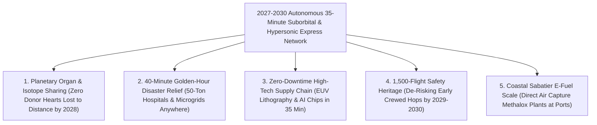

# VISION 02 (THE 2026–2030 LEAPFROG): SPACE INDUSTRIALIZATION IN 48 MONTHS
## Pathway 2C: The 2026–2030 Autonomous Suborbital Cargo, Organ-Transplant & Disaster-Relief Express — *Any Two Continents in 35 Minutes*

> **The Cynic's Objection:**
> *"Point-to-point rocket travel by 2030? The FAA will never certify strapping airline passengers into a Starship that fast, sonic booms will wake up cities, and subsonic cargo jets already work fine!"*
>
> **The 2026–2030 Leapfrog Thesis:**
> You don't wait for 400-seat commercial airline certification to revolutionize global transport—**autonomous cargo, medical biologics, and emergency logistics go first in 2027–2029!** Packages, donor hearts, lithography optics, and 50-ton mobile surgical hospitals don't need FAA Part 121 passenger cabin certification, and they tolerate $3g\text{–}4g$ ballistic profiles with zero complaints. By combining **SpaceX Starship's point-to-point offshore platforms**, **Sierra Space's *Ghost* and *Dream Chaser* precision reentry pods**, **Dawn Aerospace's same-day runway rocketplanes**, and **Venus Aerospace's Mach 9 RDRE hypersonic drones**, humanity leapfrogs 16-hour subsonic air freight inside 48 months—delivering ultra-critical payloads between any two continents in **35 minutes** by **2028–2029**, and inaugurating early emergency/executive crewed sorties by **2029–2030**.

---

## ACT I: THE 2030 REALITY (AFTER A 48-MONTH SUBORBITAL SPRINT)
### A Tuesday Morning in Late 2029 — A Donor Heart Across the Pacific in 31 Minutes and a 50-Ton Hospital in the Golden Hour

Imagine standing at a coastal hospital heliport in Sydney—or at a semiconductor foundry in Hsinchu, or an earthquake disaster zone in the Andes—on a Tuesday morning in **late 2029**.

Four years earlier, in 2025, pundits assumed suborbital point-to-point flight would remain a distant 2040 passenger dream stalled by aviation regulators. Instead, aerospace operators executed the **2026–2029 Autonomous Cargo & Medical Leapfrog**:

1. **The 31-Minute Transpacific Organ & Biologics Express:**
   A rare HLA-matched donor heart or a batch of short-half-life Actinium-225 targeted cancer isotopes (which decay in hours) is loaded into an autonomous **Sierra Space *Ghost* / Dawn *Aurora* reentry pod** or a **Venus Mach 9 RDRE hypersonic drone** on the California coast. Climbing above the dense troposphere into frictionless near-space, the vehicle coasts across the Pacific at Mach 9 to Mach 22 and lands gently at a coastal runway or offshore barge near Sydney **31 minutes later**—long before cellular ischemia or radioactive decay can occur.
2. **50-Ton Mobile Hospitals Anywhere on Earth in 38 Minutes:**
   Twenty-five kilometers off the coast of Texas and Florida, an uncrewed **Point-to-Point Cargo Starship** (operating under the **U.S. Space Force / Civil Reserve *Rocket Cargo* framework**) lifts off from a converted offshore platform fueled by solar Sabatier e-methane. Thirty-eight minutes later, it touches down on a stabilized offshore barge or reinforced landing pad near a typhoon-ravaged archipelago—unloading a **50-ton self-contained surgical hospital, solar-battery microgrid, and water desalination plant** inside the first Golden Hour.
3. **Zero-Inventory Semiconductor & AI Supply Chains:**
   When a \$400 million EUV lithography mirror in Taiwan or Arizona needs an emergency replacement module from Veldhoven, Netherlands, it no longer loses 36 hours on a subsonic Boeing 747 freighter. It arrives via suborbital express in **34 minutes**, saving \$10 million per hour in avoided fab downtime.
4. **Early Emergency & Executive Crewed Sorties (2029–2030):**
   Having logged **1,500+ consecutive autonomous orbital and point-to-point cargo landings by 2029**, winged Mach 5–9 spaceplanes and offshore Starships begin flying vetted surgical trauma teams, emergency responders, and early commercial pioneers across oceans in **under 45 minutes**.

---

## ACT II: THE 2026–2028 CONVERGENCE BRIDGE — WHY CARGO LEAPFROGGED FIRST
### Ballistic Vacuum Coasting, Mechazilla Catches, and Rotating Detonation Rocket Engines

### Step 1: The Three Physics & Regulatory Unlocks That Made 2027–2030 Possible
Why did autonomous suborbital cargo and hypersonic express scale ten years faster than mass passenger liners?

* **1. Climbing Above the Drag Wall ($t_{\text{ballistic}} \le 42\text{ Minutes}$ Globally):**
  Aerodynamic drag inside the lower atmosphere scales with air density $\rho$ and velocity squared ($F_{\text{drag}} = \frac{1}{2}\rho v^2 C_d A$). By ascending above $80\text{–}100\text{ km}$ where $\rho \rightarrow 0$, an autonomous suborbital rocket coasts along a frictionless Keplerian ellipse at $6.8\text{ to }7.6\text{ km/s}$ with **engines completely off**:
  $$t_{\text{max}} \approx \pi \sqrt{\frac{R_{\text{Earth}}}{g}} \approx 42\text{ minutes (maximum ballistic coast between any two antipodal points on Earth)}$$
  On arrivée, Earth's atmosphere provides **99.5% of the braking energy for free** via aerobraking before a brief landing burn or runway flare.
* **2. The Cargo-First Regulatory & G-Load Shortcut:**
  Certifying a vehicle for 400 ticketed airline passengers requires thousands of flights and gentle $<2g$ cabins. By contrast, **autonomous uncrewed cargo pods and hypersonic drones** operate under streamlined **FAA Part 450 / experimental point-to-point corridors** over open ocean, tolerate $3.5g\text{–}5g$ reentry profiles, require zero heavy life-support systems, and command **\$500 to \$5,000 per kilogram** for time-critical organs, radioisotopes, and semiconductor optics—paying for the fleet on day one.
* **3. Raptor 3, Rotating Detonation (RDRE) & Drop-from-Orbit Precision Pods:**
  Three distinct hardware classes converged in 2025–2026 to cover every payload tier from $50\text{ kg}$ to $100\text{ tons}$:
  * **Orbital Pre-Positioned Drop Pods (*Sierra Space Ghost* & *Varda/Inversion*):** Compact lifting-body/parafoil capsules stored in LEO that deorbit on 15 minutes' notice to deliver $100\text{–}500\text{ kg}$ of blood plasma, trauma kits, or spare parts within $50\text{ meters}$ of any target on Earth.
  * **Runway-to-Runway Rocketplanes & RDRE Drones (*Dawn Aurora*, *Venus Aerospace*, *Hermeus*):** **Rotating Detonation Rocket Engines (RDRE)** spin supersonic detonation waves around an annular channel, delivering **15%–20% higher thermodynamic efficiency** and enabling Mach 5 to Mach 9 autonomous express drones from standard coastal runways.
  * **Heavy Point-to-Point Starship (*Raptor 3* + Mechazilla):** With $280\text{ tf}$ Raptor 3 engines (requiring no external heatshields) and precision tower/barge catches proven in 2024–2026, a single Starship moves **50 to 100 tons** across any ocean in 35 minutes.

### Step 2: Verified 2025–2026 Flight Baseline Powering the 2027–2030 Sprint

| Operator / System | Verified 2025–2026 Hardware Milestone | The 2027–2030 Point-to-Point Leapfrog |
| :--- | :--- | :--- |
| **SpaceX (*Starship & Super Heavy*)** | Multiple **Mechazilla chopstick tower catches**; controlled Indian Ocean ship landing burns; $280\text{ tf}$ **Raptor 3** production. | **2027–2030:** Offshore barge-to-barge autonomous **50–100 ton cargo hops** in 35 minutes; early crewed emergency/pioneer flights by 2029–2030. |
| **Sierra Space (*Ghost* & *Dream Chaser*)** | Completed *Dream Chaser Tenacity* spaceplane verification; flight-tested **Ghost** precision autonomous reentry cargo pods. | **2026–2029:** Pre-positioned orbital **Ghost** pods delivering emergency medical/logistics payloads anywhere in **<45 minutes**; *Dream Chaser* runway returns. |
| **Venus Aerospace (*RDRE* & *VDR2*)** | Flight-tested world's first high-thrust **Rotating Detonation Rocket Engine (RDRE)** and **VDR2** Mach 6–9 detonation ramjet (2024–2026). | **2027–2029:** Autonomous **Mach 9 hypersonic express drones** flying coastal runway-to-runway transpacific medical and chip-fab sorties in **55 minutes**. |
| **Dawn Aerospace (*Mk-II Aurora*) & Hermeus** | **Dawn:** Supersonic runway-takeoff rocketplane with same-day turnaround. **Hermeus:** *Quarterhorse* flight tests of Chimera TBCC engine. | **2026–2029:** Daily autonomous Mach 3–5 express micro-cargo and organ-transport corridors across North America, Europe, and Asia-Pacific. |
| **USSF / AFRL (*Rocket Cargo Vanguard*)** | Active contracts with SpaceX, Sierra Space, and Blue Origin for rapid global humanitarian & logistics point-to-point delivery. | **2027–2028:** Full operational demonstration of **50-ton mobile hospital and microgrid delivery** across transoceanic distances in under 60 minutes. |

---

## ACT III: THE 48-MONTH SPRINT ROADMAP (2026 $\rightarrow$ 2030) & ROUTE ECONOMICS

### 1. The 4-Year Rollout Sprint: From Orbital Drop Pods to 35-Minute Transoceanic Express

| Sprint Year | Vehicle Class & Operational Milestone | Payload, Speed & Turnaround Specs | Terrestrial Bottleneck Skipped |
| :--- | :--- | :--- | :--- |
| **2026** *The Pathfinder Year* | **Sierra *Ghost*** & **Inversion** orbital drop pods operational; **Dawn *Aurora*** & **Hermeus *Quarterhorse*** high-speed runway flights; **Starship** land/tower ship catches. | $50\text{–}500\text{ kg}$ express pods; Mach 3–22 profiles; Same-day runway turnaround | Bypasses destroyed airports and roads during disasters by dropping precision parafoil pods directly to field coordinates. |
| **2027** *Autonomous Express* | First **USSF Rocket Cargo Starship** point-to-point transoceanic demo ($50\text{ tons}$ in $38\text{ min}$); **Venus RDRE** Mach 6–9 autonomous drone flights. | **500 kg–50 Tons**; **35–55 Min** transoceanic; Oceanic & coastal corridors | **Ends the 12-hour organ & isotope ceiling:** Donor hearts, kidneys, and short-lived cancer isotopes cross oceans before cell degradation. |
| **2028** *Commercial Cargo Hubs* | **4 offshore floating Starship/barge ports** (Gulf Coast, Pacific, Europe, Australia) + **12 coastal hypersonic runway hubs** run daily express schedules. | **6 flights/day** per drone; **\$200–\$600/kg** bulk cargo; Sabatier e-methane fuel | Semiconductor fabs (TSMC, Intel, ASML) and biologics makers shift ultra-critical supply chains from 36-hour air freight to **35-minute suborbital express**. |
| **2029–2030** *Golden-Hour & First Crews* | **1,500+ consecutive safe cargo landings** logged; **UN/Red Cross Golden-Hour Disaster Fleet** active; first **emergency surgical teams & pioneer crews** fly point-to-point. | **50–100 Tons** in **35 Min**; Gentle **$2.0g$** crewed profiles; 100% net-zero Sabatier fuel | Any natural disaster on Earth receives a **50-ton mobile trauma hospital and solar microgrid in 40 minutes**; human transoceanic hops begin. |

### 2. Quantitative Comparison: Legacy Subsonic Air Freight vs. 2028–2030 Suborbital Express

| Global Logistics Metric (2027–2030 Horizon) | Boeing 777F / 747-8F Subsonic Freighter | 2028 Mach 9 RDRE Drone (*Venus/Dawn*) | 2028–2029 Point-to-Point Cargo Starship |
| :--- | :--- | :--- | :--- |
| **Los Angeles $\leftrightarrow$ Tokyo Transit Time** | **$11\text{ hr } 30\text{ min}$** (+ 6 hr ground handling) | **$54\text{ Minutes}$** (coastal runway-to-runway) | **$34\text{ Minutes}$** (offshore port-to-port) |
| **London $\leftrightarrow$ Sydney Transit Time** | **$21\text{ Hours}$** (with refueling stop) | **$98\text{ Minutes}$** (oceanic boost-glide) | **$41\text{ Minutes}$** (ballistic vacuum coast) |
| **Viable Donor Heart / Isotope Radius** | **$2,500\text{ km}$** ($<4\text{ hr}$ cold ischemia limit) | **$20,000\text{ km}$ (100% of Earth in $<90\text{ min}$)** | **$20,000\text{ km}$ (100% of Earth in $<42\text{ min}$)** |
| **Emergency Disaster Payload per Sortie** | $100\text{ tons}$ (requires intact $3,000\text{ m}$ runway) | $1\text{–}5\text{ tons}$ (standard coastal airstrip) | **$50\text{–}100\text{ Tons}$ (vertical landing, no runway)** |
| **Daily Transoceanic Sorties per Vehicle** | **1.2 flights/day** | **6–8 flights/day** | **6–10 flights/day** |
| **Carbon & Soot Footprint** | Fossil Jet-A kerosene + high-altitude soot | Zero-soot $\text{LH}_2$ / clean methalox RDRE | **Net-Zero Coastal Sabatier E-Methane** |

### 3. The Three-Tier 2028–2030 Point-to-Point Express Architecture
Rather than forcing one vehicle to serve every mission, the 2027–2030 network pairs three complementary autonomous platforms:

| Express Tier | Vehicle Class | Payload Mass | Landing Footprint | Primary 2027–2030 High-Margin Cargo |
| :--- | :--- | :--- | :--- | :--- |
| **Tier 1: Orbital Drop-On-Demand** | **Sierra *Ghost* / Inversion Pods** | $50\text{–}500\text{ kg}$ | **Any $30\text{ m}$ clearing** (steered parafoil) | Matched donor organs, blood plasma, antivenom, field trauma kits, defense/grid spares. |
| **Tier 2: Runway Hypersonic Drone** | **Venus Mach 9 RDRE / Dawn *Aurora*** | $500\text{–}5,000\text{ kg}$ | **Existing coastal airports** ($2,500\text{ m}$ runway) | Actinium-225 cancer isotopes, EUV lithography optics, custom CAR-T therapies, AI wafer lots. |
| **Tier 3: Heavy Ballistic Liner** | **Point-to-Point Cargo Starship** | $50,000\text{–}100,000\text{ kg}$ | **Offshore barges & disaster pads** (vertical) | 50-ton mobile surgical hospitals, grid transformers, desalination plants, pioneer trauma crews. |

### 4. Solving Sonic Booms, Fuel Carbon & Safety Inside the 2026–2030 Window
* **25 km Offshore Barge Ports & Oceanic Corridors:** By launching and catching Cargo Starships on stabilized offshore platforms **25–35 km off coastal ports** (linked by fast electric hydrofoils and cargo barges) and routing Mach 9 drones over oceanic corridors above $50\text{ km}$ altitude, **zero sonic booms reach urban populations ($<55\text{ dBA}$ at shore)**.
* **Coastal Sabatier E-Methane Loops ($\text{CO}_2 + 4\text{H}_2 \rightarrow \text{CH}_4 + 2\text{H}_2\text{O}$):** Co-locating solar/nuclear electrolysis and direct-air-capture Sabatier reactors at offshore ports ensures every flight burns 100% net-zero synthetic methalox or green hydrogen with **zero stratospheric black-carbon soot**.
* **Cargo-First Statistical Reliability:** Instead of risking passengers on early flights, logging **1,500+ autonomous orbital Starlink deployments and point-to-point cargo sorties between 2026 and 2029** proves Raptor 3 engine-out redundancy and heatshield turnaround before the first emergency trauma team steps aboard in 2029–2030.

---

## ACT IV: THE 2030 CIVILIZATIONAL UNLOCK & SUMMARY FOR THE SKEPTIC

By starting with **autonomous cargo, medical biologics, and disaster relief in 2026–2028** rather than waiting a decade for mass passenger certification, humanity shrinks the planet to **35 minutes** before 2030:

1. **Ending Geographic Death Sentences in Transplant & Cancer Medicine:**
   Every year, thousands of viable donor hearts, lungs, and livers are discarded because a matched recipient is an ocean away, and breakthrough alpha-emitting cancer isotopes decay before subsonic planes can deliver them. By 2028, autonomous Mach 9 drones and suborbital pods turn the entire planet into a single **60-minute hospital transplant zone**.
2. **The 40-Minute Global Disaster Shield:**
   When a major earthquake or cyclone destroys local airports and power grids, survivors no longer wait 72 hours for heavy relief. A vertically landing Cargo Starship or fleet of *Ghost* reentry pods delivers **50 tons of surgical trauma units, water purifiers, and battery microgrids in 40 minutes**—requiring zero intact runways.
3. **De-Risking Human Point-to-Point Flight by 2029–2030:**
   Just as airmail pilots and cargo freighters paved the way for commercial airlines in the 1920s, flying thousands of high-margin autonomous cargo and satellite sorties between 2026 and 2029 pays for the offshore pads, Sabatier e-methane plants, and safety validation that open human point-to-point hops at the end of the decade.
4. **The Bottom Line for the Skeptic:**
   You don't need to wait until 2040 to see point-to-point spaceflight change life on Earth. **Starship's tower catches**, **Sierra Space's *Ghost* reentry pods**, **Dawn Aerospace's rocketplanes**, and **Venus Aerospace's RDRE engines** are already built and flying in 2025–2026. By 2028, critical cargo crosses oceans in 35 minutes.
