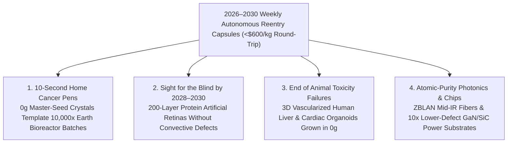

# VISION 02 (LEAPFROG 2026–2030) — SPACE EXPANSION & CISLUNAR CIVILIZATION
## Sub-Pathway 2B: Weekly Autonomous Orbital Bio-Capsules & The "Seed-Crystal" Pharma Revolution — *Turning 4-Hour Cancer IVs into 10-Second Home Pens by 2028–2030*

> **Executive Framing & The 48-Month Leapfrog Thesis**
> * **The Legacy Aerospace Bottleneck:** *"Critics assume orbital manufacturing requires waiting until the late 2030s to build giant, multi-billion-dollar commercial space stations and flying astronauts up to tend experiments by hand. At that rate, space-made medicines and optical fibers won't reach regular patients for decades."*
> * **The 2026–2030 Leapfrog Thesis:** We don't need giant crewed space stations to industrialize microgravity! Between **2024 and 2026**, **Varda Space Industries** (*W-1, W-2, W-3* Mach-25 reentry capsules), **Redwire Space** (*PIL-BOX* automated crystal labs & *BFF* 3D tissue printers), **Merck** (*Keytruda* microgravity crystallization), and **Space Forge** proved that **uncrewed, suitcase-sized microfluidic and acoustic-levitation bio-reactors** can fly on routine commercial rideshares and return directly to desert ranges or runways. Better still, the **Thermodynamic Seed-Crystal Multiplier** means you don't manufacture millions of liters of drugs in space: **1 kilogram of flawless master-seed crystals nucleated in `0 g` and returned to Earth templates 10,000+ kilograms of uniform biologics inside standard terrestrial bioreactors.** By **2028–2030**, weekly autonomous reentry capsules transform 4-hour hospital IV cancer infusions into painless **10-second home autoinjector pens**, while delivering FDA-trial artificial retinas, vascularized cardiac patches, and ultra-pure ZBLAN optical fibers.

---

## ACT I: THE WORLD OF 2030 — ORBITAL BIOLOGICS IN EVERY NEIGHBORHOOD PHARMACY
### A Tuesday Morning at a Suburban Oncology Clinic & Eye Hospital (2030)

Step inside an ordinary neighborhood pharmacy and outpatient surgical center in **2030**. Not a single patient in the waiting room is an astronaut—yet three clinical miracles happening in the building were unlocked **450 kilometers overhead inside uncrewed orbital capsules**:

1. **The 10-Second Home Cancer Pen (The Orbital Seed-Crystal Trick):**
   * In 2025, a patient receiving monoclonal antibody immunotherapy (such as pembrolizumab / *Keytruda* or nivolumab) had to drive to a hospital infusion center every three weeks and sit hooked to an intravenous line for **2 to 4 hours**.
   * Why? Because on Earth (`1 g`), buoyancy-driven convection causes giant `150 kDa` antibody proteins to clump into irregular, viscous sludge that clogs hypodermic needles.
   * By **2028–2030**, autonomous orbital capsules nucleate **perfectly uniform, monomodal micro-crystal master seeds** in pure diffusion-controlled microgravity and drop them by parachute into Utah and South Australia every Tuesday.
   * Dropped into **10,000-liter terrestrial pharmaceutical tanks**, those orbital seeds template massive batches of ultra-concentrated (`>220 mg/mL`), low-viscosity crystalline suspensions that stay stable at room temperature—turning a 4-hour hospital IV drip into a **10-second subcutaneous epi-pen injection at home**.
2. **The 200-Layer Artificial Retina & Autologous Meniscus Graft:**
   * Down the hall in ophthalmology, a 64-year-old patient blinded by **retinitis pigmentosa** receives a sub-retinal implant smaller than a dime (**LambdaVision** architecture): 200 molecularly homogeneous layers of light-activated **bacteriorhodopsin protein** deposited in zero gravity where sedimentation and convective ripples cannot smudge the film.
   * Next door in orthopedics, an athlete receives a living, scaffold-free **3D-printed knee meniscus** and a pediatric heart patient receives a **vascularized cardiac patch** (**Redwire *BFF*** platform)—printed in orbit from their own induced pluripotent stem cells (**iPSCs**) without collapsing under gravity.
3. **Mid-IR Surgical Lasers & Quantum Interconnects (ZBLAN Glass):**
   * The surgeon's laser scalpel and the hospital's quantum-secured AI diagnostic trunk run through **heavy-metal fluoride glass (ZBLAN)** optical fiber pulled inside orbital free-flyers—where heavy zirconium/barium ions and light sodium/aluminum ions never separate by weight, achieving **10x to 50x lower signal loss** than terrestrial silica glass.

---

## ACT II: THE 2026–2030 LEAPFROG ENGINE — SKIPPING CREWED STATION DELAYS
### Why Uncrewed Free-Flyers + Seed-Crystal Amplification Scale 10,000x Faster

```mermaid
flowchart LR
    subgraph Physics["The 0g Molecular Physics Edge"]
        P1["100% Diffusion-Controlled Growth<br>(Zero Buoyancy Convection in Crystals)"]
        P2["Thermodynamic Seed Templating<br>(1kg Orbital Seed -> 10,000kg Earth Batch)"]
        P3["Zero Hydrostatic Slump<br>(Scaffold-Free 3D Tissue & 200-Layer Retinas)"]
    end

    subgraph SOTA2026["2024–2026 Verified Hardware in Flight"]
        S1["Varda W-1, W-2, W-3 Reentry Capsules<br>(Mach 25 Return to Utah & Australia; $329M+ Raised)"]
        S2["Redwire PIL-BOX (28+ Missions) &<br>Merck Keytruda 0g Crystal Proofs"]
        S3["Redwire BFF Printed Meniscus/Heart<br>& LambdaVision 9+ ISS Retina Flights"]
    end

    subgraph Sprint2030["2027–2030 Weekly Capsule Economy"]
        C1["50+ Uncrewed Capsules/Yr<br>(Varda W-Series, ForgeStar, Cargo Dragon)"]
        C2["Home Subcutaneous Biologics<br>(Replacing 4-Hr Hospital IV Infusions)"]
        C3["FDA Clinical Rollout of 0g Retinas,<br>Menisci, Organoids & ZBLAN Fiber"]
    end

    Physics --> SOTA2026 --> Sprint2030
```

### Step 1: The Two Shortcuts That Make 2027–2030 Orbital Manufacturing Profitable Today
Skeptics used to ask: *"How can you ever launch enough raw chemicals to space to supply millions of patients on Earth?"* Between **2024 and 2026**, two breakthroughs answered that question decisively:

* **Shortcut #1: The 1-to-10,000 "Orbital Seed Crystal" Multiplier:**
  You **never** launch 100 tons of bulk liquid medicine to orbit!
  * Many life-saving small-molecule drugs and biologic proteins possess superior **metastable polymorphs** (crystal packing geometries) that have a high energy barrier to *initial nucleation* in Earth's convective gravity (`1 g`), where density currents disrupt delicate pre-critical molecular clusters.
  * Inside an automated microfluidic cassette in `0 g` (such as **Redwire's *PIL-BOX*** or **Varda's *W-series***), those molecules nucleate cleanly into uniform master crystals.
  * Once formed and returned to Earth inside a 50-kilogram reentry capsule, **just 1 kilogram of orbital master-seed crystals** is added to a standard **10,000-kilogram terrestrial stirred-tank bioreactor**. Because crystal growth on an existing seed face has a much lower thermodynamic barrier than primary nucleation, the terrestrial vat copies the exact space-born crystal structure—delivering **10,000x mass leverage** from a single capsule flight!
* **Shortcut #2: Uncrewed Free-Flying Reentry Capsules (Skipping the Astronaut Tax):**
  Instead of waiting for human-rated space stations that cost billions to maintain life support, **Varda Space Industries** proved in **2024–2025 (*W-1, W-2, W-3*)** that a compact, solar-powered satellite bus carrying a **90-centimeter hypersonic reentry capsule** can launch on a routine SpaceX Falcon 9 Bandwagon/Transporter rideshare, run an automated crystallization furnace in orbit for 3 to 8 weeks, and dive back through the atmosphere at **Mach 25** to land under a precision parafoil in Utah or South Australia.

### Step 2: 2025–2026 Verified Hardware & 2027–2030 Commercial Scale Matrix

| Company / Platform | Verified 2024–2026 Flight Record | 2027–2028 Capsule / Lab Deployment | 2029–2030 Clinical & Commercial Output |
| :--- | :--- | :--- | :--- |
| **Varda Space Industries (*W-Series* Capsules)** | **2024–2025:** Completed *W-1, W-2, W-3* orbital missions & Mach-25 returns to Utah (UTTR) and Koonibba, Australia; isolated 3rd stable polymorph of **ritonavir**; raised **\$329M+**. | Scaling from quarterly to **bi-weekly/weekly uncrewed *W-4+* capsule flights** with multi-zone microfluidic reactors. | Routine contract nucleation of proprietary drug polymorphs & biologic master-seed crystals for top-20 pharma companies. |
| **Redwire Space (*PIL-BOX*) & Merck (*Keytruda*)** | Flew **28+ *PIL-BOX* pharma missions** with Eli Lilly, BMS, & Butler Univ; Merck proved uniform, low-viscosity `0 g` crystalline **pembrolizumab (*Keytruda*)** suspensions. | Deploying high-throughput automated *PIL-BOX* arrays on commercial free-flyers, Vast *Haven-1*, and Dragon cargo pods. | **10-second subcutaneous autoinjector formulations** of blockbuster oncology/autoimmune biologics entering clinic by 2028–2030. |
| **LambdaVision (Artificial Human Retina)** | Completed **9+ ISS microgravity flights** proving automated 200-layer deposition of **bacteriorhodopsin** protein thin films; partnered with Redwire for GMP scale-up. | GMP-grade automated orbital dip-coating modules flying on Dragon and commercial capsules (`1 flight = hundreds of retinas`). | **First-in-human FDA clinical trials (2027–2029)** and breakthrough designation for retinitis pigmentosa & macular degeneration. |
| **Redwire (*BFF*) & Prometheus Life Tech** | **2023–2025:** Printed first living human knee meniscus & vascularized cardiac tissue on ISS via *BioFabrication Facility*; Prometheus won NASA/NSF Organoid Prize. | Acoustic-levitation & multi-head extrusion bioprinters paired with gentle **`<1.5 g` lifting-body (**Dream Chaser**) & Dragon returns**. | Patient-specific **3D human liver/brain/cardiac organoids** replacing animal toxicity trials + first autologous meniscus implants. |
| **Flawless Photonics & Space Forge (*ForgeStar*)** | Drew multi-hundred-meter defect-free **ZBLAN fluoride fibers** on ISS; Space Forge launched *ForgeStar* wake-shield foundry with *Pridwen* radiative heatshield. | Uncrewed high-vacuum free-flyers pulling multi-kilometer ZBLAN spools and growing ultra-pure **$\text{GaN / SiC / Ga}_2\text{O}_3$** seed wafers. | Commercial mid-IR surgical fiber lasers, quantum telecom links, and wide-bandgap semiconductor master substrates (`10x` fewer defects). |

---

## ACT III: THE 48-MONTH SPRINT ROADMAP (2026 $\rightarrow$ 2027 $\rightarrow$ 2028 $\rightarrow$ 2030)

| Sprint Year | Milestone Window | Orbital Flight Cadence & Hardware | Logistics Cost & Value Leverage | Clinical & Industrial Breakthrough Unlocked |
| :--- | :--- | :--- | :--- | :--- |
| **Year 1** | **2026: Monthly Capsule & GMP Qualification** | Varda *W-4/W-5* capsules, Space Forge *ForgeStar-1/2*, and Redwire *PIL-BOX* / *BFF* GMP qualification runs on ISS & Dragon. | Round-trip capsule cost: **\$3,500/kg**; FDA GMP validation of orbital bioreactor telemetry for human clinical use. | First space-nucleated small-molecule polymorphs & biologic seed crystals transferred into terrestrial pilot vats. |
| **Year 2** | **2027: Bi-Weekly Returns & First Human Retina Trials** | **20+ uncrewed reentry capsule touchdowns/yr** across Utah, Australia, and coastal ranges; Vast *Haven-1* hosts automated microgravity lab racks. | Round-trip cost: **\$2,000/kg**; `1 kg` of orbital seed crystals templates `10,000 kg` of terrestrial drug production. | **LambdaVision 200-layer artificial retina enters Phase I/II human clinical trials** to restore sight in blind patients. |
| **Year 3** | **2028: The Subcutaneous Biologic Inflection** | **35+ capsule & spaceplane returns/yr**; Sierra Space *Dream Chaser* provides `<1.5 g` runway landings for delicate 3D-printed vascular tissues. | Round-trip cost: **\$1,100/kg** (Starship/Falcon rideshares); orbital organoid arrays adopted by top-10 pharma pipelines. | **First orbital-seeded subcutaneous oncology biologic** converts a 4-hour hospital IV drip into a 10-second home autoinjector pen. |
| **Year 4** | **2029–2030: Weekly Autonomous Bio-Foundry Fleet** | **52+ weekly autonomous capsule landings** ("The Tuesday Drop"); multi-ton free-flying bioreactor pods docked to commercial LEO hubs (*Starlab / Haven*). | Round-trip cost: **<\$600/kg**; product value density reaches **\$1M to \$50M per returned kilogram**. | Commercial availability of **zero-scaffold 3D-printed human menisci**, vascularized drug-screening organoids, and repeaterless ZBLAN surgical/telecom fibers. |

### The Unit Economics of the 2026–2030 Leapfrog (Why Margins Exceed 1,000-to-1)
* **Why Launch Cost Is Already Non-Binding:**
  * Even at 2026 rideshare + reentry prices (**\$2,000–\$3,500 per kg**), launching and returning a `50 kg` payload costs **<\$175,000**—less than the annual fully loaded cost of one biotech lab technician:
  * **1 kg of Biologic Master-Seed Crystals:** Templates `10,000 kg` of concentrated subcutaneous antibodies on Earth $\rightarrow$ **>\$10,000,000/kg** effective value created.
  * **1 kg of Bacteriorhodopsin Retinal Implants (~2,000 implants at 0.5g each):** Restores functional vision to 2,000 patients $\rightarrow$ **>\$30,000,000/kg** clinical value.
  * **1 kg of Vascularized Human Organoids (~10,000 micro-livers/hearts):** Replaces \$5,000,000+ in failed preclinical animal toxicity screens $\rightarrow$ **>\$5,000,000/kg** R&D value.
  * **1 kg of Defect-Free ZBLAN Mid-IR Optical Fiber (~25 km spool):** Powers ultra-low-loss surgical lasers and quantum networks $\rightarrow$ **>\$1,000,000/kg** market value.
  * **1 kg of Wide-Bandgap $\text{GaN / SiC / Ga}_2\text{O}_3$ Master Boules:** Seeds ultra-low-defect power electronics wafers cutting AI data-center power conversion losses $\rightarrow$ **>\$500,000/kg**.

### Engineering Bottlenecks & 2026–2030 Hardware Mitigations

| Orbital Manufacturing Bottleneck | Why Critics Thought It Would Fail | 2026–2030 Verified Engineering Solution |
| :--- | :--- | :--- |
| **Hypersonic Reentry G-Loads & Heating (`Mach 25`, `2,700 °C`)** | Fear that atmospheric deceleration (`5–8 g`) or heat soak would crush or denature delicate space-grown crystals and tissues. | **Dual-Track Return Architecture:** Once solid seed crystals and ZBLAN fibers freeze in `0 g`, their covalent/ionic lattices easily survive `8 g` inside Varda's PICA-C thermal capsules (proven on *W-1/W-2/W-3*). Meanwhile, fragile 3D vascularized tissues ride **SpaceX *Dragon*** or **Sierra Space *Dream Chaser* (`<1.5 g` runway glide)** in active `37 °C` perfusion incubators. |
| **FDA Good Manufacturing Practice (GMP) Certification in Orbit** | Regulators require strict batch traceability and sterility without human contamination. | **Hermetically Sealed Automated Cassettes (*PIL-BOX*):** Microfluidic cassettes are filled and sterilized inside FDA-certified cleanrooms on Earth, sealed prior to launch, and operated autonomously via optical telemetry with zero human contact. |
| **Micro-Vibrations ("G-Jitter") on Crewed Stations** | Astronaut footsteps and exercise treadmills on the ISS send `10⁻³ g` vibrations through crystal baths. | **Uncrewed Free-Flyers & Magnetic Isolation:** Uncrewed capsules (*Varda W-series*, *Space Forge*) have zero crew footsteps or thrusters firing during the multi-week crystal growth window, achieving pristine `<10⁻⁶ g` quiescent microgravity. |
| **Mass Scalability for Million-Patient Drugs** | Launching thousands of tons of raw chemical solvents to LEO is economically impossible. | **Thermodynamic Seed Templating (1 : 10,000 Ratio):** Orbit is used strictly to overcome the primary nucleation barrier of metastable polymorphs; bulk crystallization happens in standard 10,000-liter vats on Earth seeded with `1 kg` of space crystals. |

---

## ACT IV: THE 2030 DIVIDEND & SUMMARY FOR THE SKEPTIC
### How Uncrewed Orbital Capsules Transform Terrestrial Medicine in 48 Months

1. **Liberating Millions of Cancer Patients from the Infusion Chair:**
   * Replacing a 4-hour hospital intravenous infusion with a room-temperature, 10-second subcutaneous pen doesn't just save billions in hospital overhead—it gives cancer and autoimmune patients back weeks of their lives and allows life-saving immunotherapies to reach rural clinics without cold-chain freezers.
2. **Replacing Animal Drug Testing Under the FDA Modernization Act:**
   * Over 90% of drugs that pass animal tests fail in humans. By **2028–2030**, scaffold-free **3D vascularized human liver, brain, and heart organoids** grown in microgravity (where blood capillaries don't collapse before maturing) give AI drug-discovery models authentic human tissue testbeds—slashing drug development timelines in half.
3. **Sovereign Biotech Access for Every University & Hospital:**
   * Because an automated *PIL-BOX* or Varda microfluidic cassette is the size of a shoebox and requires zero astronaut intervention, any university oncology lab or biotech startup can book a slot on a weekly Falcon/Starship rideshare for the price of an electron microscope—democratizing space manufacturing across the globe by **2030**.

4. **Ultra-Pure Wake-Shield Semiconductor & Photonics Substrates (2028–2030):**
   * Behind an uncrewed **Space Forge *ForgeStar*** molecular wake shield moving at `7.8 km/s`, the vacuum is **1,000 to 1,000,000 times cleaner** than terrestrial cleanrooms—allowing defect-free epitaxial deposition of wide-bandgap **gallium nitride ($\text{GaN}$), silicon carbide ($\text{SiC}$), and gallium oxide ($\text{Ga}_2\text{O}_3$)** master wafers that slash AI data-center and EV power-conversion losses by up to `50%`.
   * Simultaneously, multi-kilometer draws of heavy-metal **ZBLAN fluoride glass fiber** in `0 g` deliver `0.005 dB/km` mid-infrared optical waveguides for repeaterless quantum networks and minimally invasive laser surgery by **2029–2030**.

### The 48-Month Leapfrog Snapshot (2026 vs. 2030)
* **Orbital Return Cadence:** `2–4` experimental capsule/ISS returns per year (2025–2026) $\rightarrow$ **`52+` weekly autonomous capsule & `<1.5 g` spaceplane touchdowns per year (2030)**.
* **Round-Trip Logistics Cost:** `\$3,500–\$6,000/kg` (2026) $\rightarrow$ **`<\$600/kg` via commercial rideshares and reusable parafoil capsules (2030)**.
* **Oncology Biologic Delivery:** `2–4 hour` hospital intravenous infusions every 3 weeks $\rightarrow$ **`10-second` room-temperature home subcutaneous autoinjector pens templated by `0 g` master-seed crystals (2028–2030)**.
* **Regenerative Medicine:** Preclinical ISS demonstrations $\rightarrow$ **Active human FDA clinical trials for 200-layer artificial retinas and autologous 3D-printed knee menisci / cardiac patches (2028–2030)**.
* **Preclinical Drug Screening:** `90%` clinical failure rate from animal toxicity models $\rightarrow$ **High-throughput AI drug screening on vascularized 3D human liver, heart, and brain organoids grown in `0 g` (2029–2030)**.

> **Bottom Line for the Skeptic:**
> You don't need a trillion-dollar space station in 2045 to make orbital manufacturing work. **Varda's reentry capsules have already landed in Utah and Australia; Merck and Redwire have already crystallized *Keytruda* and printed human menisci in orbit; LambdaVision's artificial retinas are already preparing for human trials.** By combining weekly uncrewed reentry capsules with the **1-to-10,000 Seed-Crystal Multiplier**, space becomes Earth's master molecular forge by **2030**:
> * **1 Kilogram of Orbital Master-Seed Crystals** $\rightarrow$ **Templates 10,000+ Kilograms of Subcutaneous Biologics on Earth.**
> * **Weekly Uncrewed Reentry Capsules (`<\$600/kg`)** $\rightarrow$ **Returns Products Worth \$1,000,000 to \$50,000,000 per Kilogram.**
> * **Zero Astronaut Labor Required** $\rightarrow$ **Every Biotech Lab and Hospital Network on Earth Gains Direct Access to Microgravity.**
